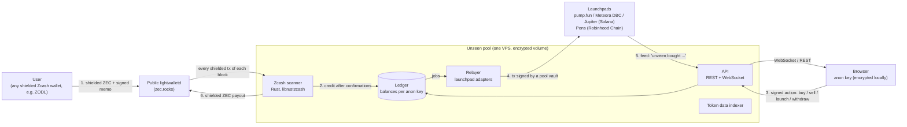

# Unzeen

> **Launch anywhere. Stay unzeen.**

**Private trading for launchpads, paid with shielded ZEC.**

You top up once from any Zcash wallet with shielded ZEC. From that balance you buy, sell and launch tokens on launchpads: **pump.fun** on Solana (mainnet and devnet, including launches paired with ZEC), **Meteora DBC** on Solana devnet, anything **Jupiter** routes on Solana mainnet, and **Pons** on Robinhood Chain. Shared pool vaults execute the trades. The public feed says *"unzeen bought 1.2M $PEPE for 0.4 SOL"*. It never says who.

- No wallet, no email, no sign-up. Your account is a 12-word **anon key**, generated and encrypted in your browser.
- The price stays public, because the bonding curve and the trades are on chain. The participants stay private. That is the dark-pool idea behind the **Private Markets** track.
- Built for **ZECATHON 2026**, track **Private Markets**.

**Live demo: https://stayunzeen.live** (Devnet / Mainnet switch in the header) · **Video: https://youtu.be/N5riLT9ULwA** · X: [x.com/stayunzeen](https://x.com/stayunzeen)

---

## Try it

- **Devnet (recommended for judges).** Open https://stayunzeen.live, keep the network switch on **Devnet** and import one of the pre-funded demo keys from [Demo keys for judges](#demo-keys-for-judges-devnet). Everything runs for real on Zcash testnet and Solana devnet: top-up, launch, buy, sell, orders, scenarios, chat, withdrawals and Verify.
- **Mainnet.** Real ZEC and real venues. Minimum deposit 0.001 ZEC; minimum action 0.0001 ZEC on Solana (0.001 ZEC on Robinhood Chain). Read the [mainnet warning](#what-is-real-and-what-is-a-mock) first, or just watch the video.
- **Public APIs** (read-only endpoints, no key needed): `GET /api/pool`, `/api/feed`, `/api/tokens`, `/api/verify`, `/api/stats` on
  - Devnet: https://api-devnet.stayunzeen.live
  - Mainnet (Solana): https://api-mainnet.stayunzeen.live
  - Mainnet (Robinhood Chain): https://api-hood.stayunzeen.live

### See it on chain (Solana mainnet, recorded for the demo video on October 25, 2026)

Every transaction below is signed by a public pool vault. Nothing on chain points to the person who asked for it.

| What | Transaction |
|---|---|
| Buy of a live third-party pump.fun token | [`52SfdCUw…kYpeU`](https://solscan.io/tx/52SfdCUwLerYLMgzTXmRnDQUinJ3nhbkAy1fgG9hkLxaRDL5Hqe4hd2AwA61U6vZwjEhzsfNDreTvEnzrspkYpeU) |
| Sell of the same token | [`4Sr81byn…oUSqo`](https://solscan.io/tx/4Sr81bynVgrcEobJpBkUZDM6w45LF7b9M98ZzvWUeq7qfrnEbVibLJsnbj6t64J1jrCZXn7Tcc1gvX7qbzvoUSqo) |
| Anonymous launch on pump.fun, paired with ZEC (ZEC SPL), creator = a fresh pool address | [`2xNgZkd6…3UNNa`](https://solscan.io/tx/2xNgZkd6pF1vj4DbspLPv3vEPZckQZ1McBByWPQh1Nk3Vq65i6YHLoFxvNJcNxSUV4U489G8VPry38m6oSS3UNNa) · token [`63xWF9YK…CsRDUr`](https://solscan.io/token/63xWF9YKmJ8WkTJGPcnmct1J2AW9bqKw1pmic1CsRDUr) · vault [`DsRGjrtq…7pcfd`](https://solscan.io/account/DsRGjrtqRaWrd7ZaikE7f8wdCZcxs4gAkQE9wRm7pcfd) |
| Verify: daily snapshot anchored on chain | [`3WmTVqNW…GdXVb`](https://solscan.io/tx/3WmTVqNWZyn3sJ4TkPWpgWdzbMo75PoNv5wPmAUjWzTjkRPaZzxSZhebes1Z3SJ22Dd7qMox5EP9d8HuT3GGXdVb) |

ZEC SPL mint used for the ZEC pair: [`A7bdiYdS5GjqGFtxf17ppRHtDKPkkRqbKtR27dxvQXaS`](https://solscan.io/token/A7bdiYdS5GjqGFtxf17ppRHtDKPkkRqbKtR27dxvQXaS).

---

## Contents

1. [Try it](#try-it)
2. [How it works](#how-it-works)
3. [Features](#features)
4. [Trust model](#trust-model)
5. [Threat model: what is private and what is not](#threat-model-what-is-private-and-what-is-not)
6. [What is real and what is a mock](#what-is-real-and-what-is-a-mock)
7. [Running locally](#running-locally)
8. [Built during ZECATHON](#built-during-zecathon)
9. [Roadmap](#roadmap)
10. [License](#license)

---

## How it works



1. **Account.** The browser generates a 12-word BIP-39 phrase and derives an ed25519 anon key from it (a separate key per network). The phrase is encrypted in the browser (PBKDF2, 600k iterations, AES-GCM) and never leaves it. You can export it as a backup. The server only ever sees the public key.
2. **Top up. This is the only Zcash transaction you make.** The app shows the pool's Unified Address as a ZIP-321 QR code with the address, the amount and a memo, so ZODL pays it in one scan. The memo is a compact binary record (`unz1`: "deposit to this anon pubkey"), signed by your anon key. The scanner downloads **every** shielded transaction of every block, not only the ones that pay the pool, so the lightwalletd operator cannot tell which transactions are deposits. A deposit is credited after 3 confirmations plus a random 0–3 blocks. Minimum deposit: 0.001 ZEC.
3. **Act from your balance.** Every action is an HTTP request signed by your anon key: domain-separated, bound to the chain, with a nonce and timestamp against replay, and padded to a fixed size. No Zcash transaction is involved, so the time of your deposit is not tied to the time of your trades.
4. **Execution.** A pool vault signs the transaction on the launchpad. All positions in one token sit on one vault, which acts as a shared inventory for that token. Each launch uses a fresh creator address of the pool.
5. **Exit.** Shielded ZEC goes to any Zcash address, or tokens go to a new address. Both always leave with a delay.

### Actions

| Action | What happens |
|---|---|
| Buy / Sell | ZEC is converted at the pool rate, which comes from a NEAR Intents 1Click quote refreshed in the background. A pool vault trades on the venue. Sale proceeds return to your ZEC balance. |
| Launch | A fresh creator address of the pool launches your token. The creator rights belong to your anon key in the ledger. Image metadata (EXIF) is stripped and the image is re-encoded on our server. |
| Claim creator fees | The pool collects creator fees for all tokens on a fixed schedule, never on request. Claiming is a ledger-only credit to your balance. |
| Withdraw ZEC | Shielded payout to any Zcash Unified Address after a random delay. Up to 5 payouts are batched in one transaction. |
| Withdraw tokens | Tokens go to a **new** address, always with a small gas drop, a random delay and a rounded amount. Optional *smart withdraw* splits them into 2–5 unequal parts to 2–5 addresses, each with its own delay. |
| Orders | Limit buy, limit sell, take-profit and stop-loss are kept **only in the pool's ledger**, never on chain, so nobody can hunt them. |

### Execution modes

You pick the mode next to the Buy/Sell button. The default is set in your profile and starts as **Delayed**.

| Mode | Latency | How |
|---|---|---|
| **Delayed** (default) | 30–60 s | Actions wait for the next pool batch, on a schedule that does not depend on requests, and run in random order. |
| **Max privacy** | 5–15 min | Same as Delayed, with longer batches. |
| **Now** | ~1–3 s | Runs immediately. Only for buy, sell and launch, never for withdrawals. A small flat fee is taken from your balance. |

Every pool transaction, in every mode, uses the same quantized priority fee and (on Solana mainnet) the same Helius Sender tip, so a Now trade carries no on-chain marker. What Now does **not** protect against is described in the [threat model](#execution-modes-and-network-timing).

### Pool liquidity

User balances are in ZEC, and the venues need SOL or ETH. The pool converts its own ZEC to SOL or ETH with **NEAR Intents 1Click** in fixed-size lots. 1Click accepts only transparent ZEC, so a lot moves from the pool's shielded wallet to the pool's own transparent address, then through 1Click to a rebalance address, and from there to the vaults. This flow is pool-level: lot sizes and timing do not depend on any user's action. The operator also adds working capital to the pool as plain shielded ZEC without a memo, so money enters the pool only as ZEC. On the demo deployment the operator triggers rebalancing by hand; the scheduler exists in code but is switched off.

### Verify

`/verify` lets anyone check the pool's solvency without learning anything about its users. See [Trust model](#trust-model).

<!-- FAIR-LAUNCH:BEGIN -->
### Fair launch (sealed bids)

A launch can run as a sealed-bid fair launch. This is the most direct form of "the price is public, the participants are not":

1. **Bid window.** Each participant's amount is encrypted in the browser with **drand timelock (tlock, quicknet)** to a round that comes after the window closes. Until that round nobody can read the bids: not other bidders, not the creator, not the operator. The browser never talks to drand, because the quicknet parameters are pinned in the client. The balance hold is a **denomination** from a fixed grid (0.05 / 0.1 / 0.25 / 0.5 / 1 / 2.5 / 5 / 10 ZEC), and the sealed amount is at most that denomination.
2. **Commitment root.** When the window closes, before the drand round, the pool builds a Merkle tree whose leaves are hashes of the ciphertexts, with no contents. It publishes the root through the API and writes it to Solana in a memo transaction signed by a dedicated fair-launch attestation key. That transaction is an unforgeable timestamp: the set of bids was fixed before anyone could decrypt it. Each participant can check that their bid is included.
3. **Reveal and execution.** After the drand round the server verifies the round signature, decrypts the bids and sends **one atomic transaction: create + buy(sum of all bids)**. The mint does not exist before this transaction, so nobody can buy earlier or at the launch price.
4. **Allocation.** Everyone gets the same price. Tokens are split pro rata (rounded down, dust stays with the pool). The total buy is capped at 25 % of supply by default, and oversubscription scales every bid down by the same ratio. The creator's own bid is bound by the 5 % creator cap.

The bid count is shown only when there are at least 5 bids ("<5" otherwise). The ciphertexts are never published.

**Mainnet option (Jito bundle).** A single vault can only spend what it holds. For large launches the code can split the launch buy over up to 5 vaults in **one Jito bundle** (create + buy from vault A, then buys from B, C and so on). The leg sizes depend only on the public total and vault balances, never on single bids. This path is implemented and unit-tested but has **not** run on mainnet: Jito has no devnet, and in this version fair launches run on Devnet only.

**Honest limits.**
- Before the round the operator sees each bid's denomination, which is an upper bound. The exact amount becomes known only after the round, to everyone at once.
- Nobody can buy before the launch or at the launch price, but anyone can buy right after it, in the same slot and at a higher price. The round time is public.
- The on-chain attestation proves **when** the bid set was fixed, not **what** it contained. The sum of the bids cannot be checked publicly, because the ciphertexts are not published.

Fair-launch libraries: `tlock_age` and `drand-verify` (Rust), `tlock-js` (browser). Only the server talks to drand quicknet relays.

Fair-launch attestation key: `TODO(lead): pubkey`.

Status: tested end to end on Devnet (3 sealed bids, commitment root, reveal, one create + buy). It was compiled out of the public frontend bundle and disabled on the server until October 28.
<!-- FAIR-LAUNCH:END -->

---

## Features

**Core**
- Account on an anon key (12 words). No email, no wallet.
- ZEC balance: top up once from ZODL with a ZIP-321 QR, then act instantly from the balance.
- Buy and sell on pump.fun (Solana mainnet and devnet; SOL and ZEC SPL pairs on mainnet), Meteora DBC (Solana devnet) and through Jupiter (Solana mainnet). Launch, buy and sell on Pons on Robinhood Chain.
- Anonymous token launch with a fresh creator address for every token.
- Creator fee claims to your balance.
- Withdraw ZEC to any shielded address. Withdraw tokens to a new address with gas, delay and an optional split.
- Live feed *"unzeen bought…"*, token pages with chart and trades.
- Execution modes Now, Delayed and Max privacy.
- Verify: Merkle-sum proof of liabilities, signed public vaults, ZEC reserve attested by the operator. No viewing key, ever.

**Extra**
- Private limit, take-profit and stop-loss orders, stored only in the pool's ledger. Open orders expire after at most 72 h and run only in Delayed or Max privacy.
- Scenarios: multi-step plans (for example buy, wait, sell part, withdraw) executed by the pool, with privacy floors enforced on the server.
- Smart withdraw: 2–5 addresses with random delays.
- Anonymous creator cabinet: fees, volume, holders and claims for tokens launched by your key.
- Anonymous token chat. Your nickname is different under every token, so nicknames do not link across tokens.
- Token safety panel: mint and freeze authority, top-10 holders and dev share (pool vaults excluded), curve progress, graduation, socials. Tokens launched through Unzeen show **"dev anonymous, rules enforced"**: the pool locks the creator's initial buy for 24 h and caps the creator's share at 5 % of supply.
- Fast trading: presets, slippage and priority settings, hotkeys, a position panel, draggable order lines on the chart, impact-aware quotes. PnL and your own trade markers are computed **in the browser only**.
- Pulse (New / About to graduate / Graduated), watchlist, local price alerts, PnL history with CSV export. All personal data stays on your device.
- Token list with filters and search by contract address.
- Public `/stats`: a daily rounded snapshot; any category with fewer than 5 events shows "<5".
- User docs at `/docs`.

The browser never calls a blockchain RPC, Jupiter or an IPFS gateway directly. All market data comes through our backend. The page loads no third-party fonts, scripts or analytics.

---

## Trust model

In this version Unzeen is a **custodial pool**. We say so plainly.

**The operator is trusted with:**
- **The keys.** The operator holds the vault keys and the pool's Zcash spending key, so the operator could steal funds.
- **The ledger.** The operator knows which anon key holds what and which actions it took, so the operator could link an anon key to its trades. The operator never learns who is behind an anon key.
- **The rules.** The operator enforces the creator lock and cap, order execution and payouts.

**What reduces that trust, and how far it goes:**
- The ledger and the pool wallet live on an **encrypted volume** that the owner unlocks by hand after every reboot. The key of the pool seed is stored outside the data volume. Provider snapshots and backups are off.
- Retention is short. Action amounts are zeroed after **24 h**. Journals and finished jobs are deleted after **48 h**. What cannot be deleted is the **current** state: balances and open positions.
- The pool's viewing keys are **never published**, not even to auditors. Payouts discard the outgoing viewing key, so the pool keeps no record of whom it paid.
- Mainnet payouts above a cap (0.05 ZEC per payout on the demo) wait for manual operator approval.

**What Verify proves.** Anyone can check it, in the browser or offline with `web/public/verify/verify-proof.mjs`.

| Claim | Status | How |
|---|---|---|
| Your balance is counted in the liabilities | **Proven** to you | A daily Merkle-sum tree per asset. Each balance is split into 2–4 random pieces with fresh blinding, the tree is padded with dummy leaves to at least 1024, and each node commits to both child sums. Your signed, padded proof (64 KiB) is checked in your browser. |
| Everyone sees the same roots | **Proven** | The roots are signed by the operator's attestation key (pinned in the frontend build and listed below) and anchored in an on-chain memo transaction. |
| The vaults belong to the pool and hold the tokens | **Proven** | Each vault signs the snapshot with its own key. Balances are read at one finalized slot or block. Token liabilities must not exceed vault balances, per token. |
| ZEC SPL held on the vaults | **Counted, marked "bridged"** | Some pairs on Solana are quoted in ZEC SPL, a bridged token. It is counted 1:1 as a separate asset. Its value depends on the bridge: if the bridge fails, that part of the reserve is lost. |
| The pool holds enough ZEC | **Attested by the operator, not proven** | Proving a shielded balance without a viewing key is not possible today, and revealing individual notes would reveal deposits. The operator signs a reserve statement, rounded down to 0.01 ZEC. A ZK proof of reserves is on the roadmap. |

Verify does **not** prove:
- that the operator did not leave out users who never check their proof (a known limit of every proof-of-liabilities scheme);
- anything about whether the operator links keys to trades;
- the ZEC reserve (see above).

Verify publishes one snapshot per day: the roots and their sums, the padded tree size and the vault list. It does **not** publish the number of users, anyone else's balance, or any viewing key.

Operator attestation keys (Verify), pinned in the public frontend build:
- Devnet: `GLScqi2A3MD8djriaSRsgfxQFRtKXQqfVbbdryMv5PYZ`
- Solana mainnet: `Dh7FXBKAfdipgRx1H2LsJeULfHJBfS4wDvQ155PDZm3`
- Robinhood Chain: `0xE8B0508A914F7076022687F717Cfce2d16DC71E8`

You can compare them with `operator.pubkey` in `GET /api/verify` of each network.

---

## Threat model: what is private and what is not

The rules say leaks are disqualifying, so here is the full list, including the leaks we could not close.

### On-chain observer (Zcash, Solana and Robinhood Chain explorers)

**Zcash.**
- A deposit is a shielded transaction. Sender, amount and memo are encrypted. The pool address is public, but a shielded payment to it looks like any other shielded transaction.
- **Exception:** paying from a **transparent address** or **directly from an exchange** reveals the source and the amount, and the exchange learns that you paid Unzeen. The app tells you to pay only from a shielded balance.
- Payouts are shielded, delayed and batched.
- A weak timing hint remains: a shielded transaction in one block and a trade a few minutes later, when there are few shielded transactions per block. Crediting waits a random number of extra blocks, and the app suggests topping up in advance.
- The pool's own rebalancing lots (shielded → pool transparent address → NEAR Intents) are visible on chain. They are pool-level, fixed in size and not tied to any user.

**Solana and Robinhood Chain.**
- Every trade, launch and withdrawal is signed by one of the pool's **public vaults** (listed on `/verify`). An observer can attribute it to "Unzeen", but never to a person, a Zcash transaction, a deposit or an anon key. That mapping exists only in the pool's ledger.
- A fresh creator address per launch means two launches by the same person are not linked on chain.
- Delayed and Max privacy trades run in batches in random order. Now trades look the same on chain. Order-triggered trades use the same minimum-output rule as manual trades (from the public price, rounded to 3 significant digits), so the trigger price cannot be read from the transaction.

**What an on-chain observer can still do:**
- **Group Unzeen trades by token.** If you are the only Unzeen user trading a small token, all Unzeen trades in it are yours. That reveals a pseudonymous position, not an identity.
- **Match a token withdrawal to a buy by amount.** Withdrawals are rounded and fuzzed, and the app warns when an amount matches a recent buy, but withdrawing about the whole position soon after one buy is still suggestive. Wait, or use smart withdraw.
- **See that the recipient was funded by Unzeen**, because the gas drop comes from a pool vault. Keep the recipient separate from your main wallet.
- **Probe orders at the pool level.** By moving the price and watching for "unzeen sold", someone can learn that the pool has a stop near a level. It never reveals who placed it.
- **Exploit a small anonymity set.** Privacy grows with the number of users. With a handful of users during judging, batches often hold zero or one action, and an Unzeen trade in a quiet token is almost certainly one person's. We do not fake traffic to hide this.

### Network observer

Your ISP, Wi-Fi operator, VPN provider, or our hosting provider can see **when** you talk to our server, but not what you send: traffic is TLS and request bodies are padded to a fixed size.

<a id="execution-modes-and-network-timing"></a>
**Execution modes and network timing.** Every trade is executed by a shared pool vault, so the chain never shows who traded. What remains is timing.
- **Delayed** (the default) and **Max privacy**: actions wait for the next pool batch and run in random order, so someone watching your connection can only narrow your request down to a batch. That protection is only as strong as the number of other people in the same batch. While Unzeen's volume is small, it is weak.
- **Now** protects you against **on-chain observers**, not against **network surveillance**. On chain it looks exactly like every other pool trade: same fee profile, no marker. But anyone who sees your connection can match the moment you sent a request to the trade that follows 1–3 s later. If that matters to you, **use Tor or a trusted VPN, or use Delayed.** Choosing Now also makes the batches that Delayed users hide in smaller.
- **Withdrawals are never instant.** An instant withdrawal would link a trade to the receiving address on chain, not only on the network.
- We never fetch prices or fee estimates at the moment of your action. Rates and fee levels refresh in the background on a fixed schedule.

Other measures:
- Action status comes through the regular portfolio poll (fixed interval, fixed-size response), so the end of polling does not reveal when your action ran.
- Your public key is sent in a header, never in a URL.
- Opening a transaction in an explorer from the app reveals your IP to that explorer. Use Tor or a VPN for explorers.

### Hosting provider (VPS)

- Sees network metadata: client IPs and the timing of requests to our server, the same as the network observer above.
- Does **not** get our logs, because there are none to get. Access logs are off, forwarded IPs are never logged, rate limits live in memory, framework telemetry is off and container logs rotate. No CDN or third-party proxy sits in front of the server.
- Data at rest is on an encrypted volume with manual unlock.
- **Not covered:** a provider that reads the memory of the running, unlocked machine can read the ledger. That is part of operator trust.

### lightwalletd operators

- We do not run our own Zcash node. The scanner uses public lightwalletd servers (zec.rocks).
- The scan server sees the pool server's IP and what it downloads. Because the scanner downloads every shielded transaction of each block, it cannot tell which ones are deposits.
- On mainnet, payouts are broadcast through **a different lightwalletd operator** than the scan servers, so neither one sees both the wallet's downloads and its broadcasts.
- **What is still visible:** the lightwalletd that receives the broadcast sees that the pool sent a transaction, and when. It does not see the recipient or the amount. Closing this needs our own node or Tor (roadmap).

### RPC and API providers

All RPC traffic comes from our server; the browser never calls an RPC. Providers never see user IPs or anon keys, only pool-level activity.
- **Solana:** reads and sends are split across providers. Shyft serves the reads. Helius gets only background priority-fee estimates, transaction sends through Helius Sender, and the top-10-holders call.
- **Robinhood Chain:** reads go through Alchemy, sends through the public chain RPC.
- **Token lookups** by contract address run on the indexer's schedule, in fixed-size batches padded with **decoy** tokens, never at the moment you search. This blurs the link "someone looked up X, then the pool bought X", but does not remove it completely.
- **Jupiter** (Solana mainnet) sees the vault, the token and the amount when a trade is routed through it. It is never called for user quotes or page views: quotes come from a background grid. Transactions are built, checked against an instruction allowlist, simulated and sent by our own pipeline.
- **NEAR Intents 1Click** sees only the pool's own rebalancing: a background rate quote and fixed-size pool lots. It learns nothing about users or the timing of their actions, and it is never used for user payouts.
- **Pinata** (optional, token metadata) stores the public metadata of tokens launched through the pool.
- A provider that keeps logs (or is compelled to share them), combined with the hosting provider's network view, could correlate Now trades with request times. This is the same caveat as Now above.

### Database leak

If the ledger database leaked:
- within 24 h of an action, its amounts could be matched to the public trade; after 24 h amounts are zeroed, and after 48 h journals are deleted;
- current balances and open positions would remain, and a position from a single buy equals the amount of that public buy;
- the pool wallet database holds the decrypted deposit memos (anon pubkeys) and transaction ids.

This is why everything sits on the encrypted volume, but it remains part of operator trust.

### Creator rules

The creator lock (24 h) and cap (5 % of supply) apply to **the launching anon key**. A creator can bypass them with a second anon key. The pool cannot close that gap without linking keys, which would break privacy. The app says "rules apply to the launching key". There is no numeric creator reputation ("N launches, M rugs"), because it would link launches by construction.

### Your device

The encrypted key, UI preferences and local data (watchlist, alerts, PnL history, scenario drafts) live in browser storage, encrypted where they are personal. Anyone with access to your unlocked device can see that you use Unzeen. The app never asks for your own wallet and never ties one to your anon key.

---

## What is real and what is a mock

The header has a network switch. Each network has its own backend (scanner, API, relayer, database) and its own state, so an anon key's balance on one network does not exist on the other.

| Part | Devnet | Mainnet |
|---|---|---|
| Zcash | **Real** Zcash **testnet** (TAZ), public `testnet.zec.rocks` | **Real** Zcash mainnet, `zec.rocks` |
| Trading chain | **Real** Solana **devnet** | **Real** Solana mainnet and Robinhood Chain mainnet |
| Venues | pump.fun and Meteora DBC: launch, buy, sell, withdraw | Solana: pump.fun (launch, buy, sell; SOL and ZEC SPL pairs) and Jupiter (buy, sell). Robinhood Chain: Pons (launch, buy, sell) |
| Minimums | Deposit 0.001 TAZ, action 0.001 TAZ | Deposit 0.001 ZEC; action 0.0001 ZEC (Solana), 0.001 ZEC (Robinhood Chain) |
| ZEC/SOL rate | **Fixed** rate (1Click has no testnet) | Live NEAR Intents 1Click quote |
| Pool rebalancing (ZEC → SOL/ETH) | Dry run only | Real 1Click, triggered by the operator |
| Transaction sending | Plain RPC send | Helius Sender with a uniform tip (Solana) |
| Verify | Real; snapshots can also be triggered by the operator for the demo | Real, daily |
| ZEC reserve | Attested by the operator (not a mock, not a proof) | Same |
| Demo keys | Pre-funded demo anon keys for judges, see below | None. Use your own funds at your own risk, or watch the video. |

**Verified live.** On Devnet the whole flow was run end to end in the browser against the real backend: deposit, pump.fun and Meteora DBC launch, buy and sell, orders, scenarios, chat, creator fees, token and ZEC withdrawals, and Verify with an on-chain anchor.

**Mainnet, Solana.** The demo video shows a minimal path on real funds: a shielded ZEC top-up, a buy and a sell of a live third-party pump.fun token (with the safety panel), an anonymous pump.fun launch paired with ZEC, and Verify with its on-chain anchor. The transactions are linked in [See it on chain](#see-it-on-chain-solana-mainnet-recorded-for-the-demo-video-on-october-25-2026). Withdrawals (ZEC and tokens), Meteora DBC, orders and scenarios were run on Devnet only, to keep the mainnet budget small. Jupiter is enabled on mainnet but did not route a trade in the recording.

<!-- TODO(lead): update this paragraph if live Pons trades / hood Verify anchors land before 28.10. -->
**Mainnet, Robinhood Chain.** The Pons instance is deployed with its own Zcash pool wallet (`api-hood`) and publishes daily Verify snapshots. The Pons adapter is tested against a mainnet fork. No live user trade has run on it yet, and the operator signature and on-chain anchor of its recent Verify snapshots are still pending.

**Built, not shown live.** Adapters for Raydium LaunchLab (bonk.fun, stonk.fun) and Bags are in the code and tested, but they are not enabled on any deployed instance.

**Network-dependent.** On Mainnet the full trade history of each token is on: whale, dev and sniper tags, the "whales" / "dev" filters and dev history, plus the Discovery list of fresh venue tokens. On Devnet these are off.

**Mock.** The frontend contains an **in-browser mock API** (`NEXT_PUBLIC_API_MODE=mock`, the default for local development) used for UI work and tests. The public deployment runs against the real backends.

**Mainnet warning.** Unzeen is an unaudited custodial pool. The mainnet deployment exists to show that it works with real venues. It is not an invitation to deposit meaningful funds. Mainnet sends are gated by flags, and payouts are capped.

### Demo keys for judges (Devnet)

Open https://stayunzeen.live, switch to **Devnet**, then **Key → Restore with 12 words**. Each key was topped up with 0.015 TAZ through a real shielded deposit (about 0.17 devnet SOL of buying power; minimum action 0.001 TAZ).

| # | 12 words (Devnet only) |
|---|---|
| 1 | `addict stick earth wheel tray rebuild essay demise result corn fine various` |
| 2 | `kiwi flat pink salt vague rough merit visa cigar render sibling body` |
| 3 | `spray path trend course outside miss amazing churn episode midnight blame anchor` |
| 4 | `among fancy black scan icon ridge galaxy spoon card scan camp main` |
| 5 | `pretty oil solution safe lawn film distance spoon punch trend volume please` |

These keys hold testnet funds only. A demo key is shared: if two judges use the same key, each sees the other's trades.

---

## Running locally

Requirements: Rust 1.85+ (edition 2024), Node.js 20+, pnpm 10, Docker.

All secrets live in the repo-root `.env` (git-ignored) and in `~/.unzeen/<network>/` (directories 0700, files 0600), never in the repo. Mainnet sends are refused unless explicitly allowed.

### 1. Postgres

```bash
cp .env.example .env    # set POSTGRES_PASSWORD and DATABASE_URL
docker compose -f infra/docker-compose.yml --env-file .env up -d postgres
```

Postgres binds to `127.0.0.1` only. Migrations are embedded in the core binaries and applied on start. The relayer and the indexer use their own least-privilege roles. After core has started once, apply them (idempotent; re-run after new migrations):

```bash
docker compose -f infra/docker-compose.yml --env-file .env exec -T postgres \
  psql -v ON_ERROR_STOP=1 -U unzeen -d unzeen -v pw="'<RELAYER_DB_PASSWORD>'" < infra/relayer-role.sql
# same for infra/indexer-role.sql with the indexer password
```

Then set `DATABASE_URL_RELAYER` and `DATABASE_URL_INDEXER` in `.env`.

### 2. Core (Zcash scanner and API)

```bash
cd core && cargo build --release
B=./target/release/unzeen-scanner
$B seed-keygen --out ~/.unzeen/seed.agekey   # once; set UNZEEN_SEED_KEY_FILE in .env
$B init                                      # encrypted pool seed and wallet, prints the pool address
$B serve                                     # sync and credit deposits (--payouts for ZEC withdrawals)
./target/release/unzeen-api serve            # API on API_BIND (default 127.0.0.1:8080)
curl -s localhost:8080/api/pool
```

Use `UNZEEN_NETWORK=test` for local work. Testnet ZEC (TAZ) is scarce: the faucet gives about 0.125 TAZ per day.

### 3. Relayer and indexer

```bash
cd adapters && pnpm install
pnpm keys:gen 2          # devnet vault keys in ~/.unzeen/devnet/solana
pnpm relayer:run         # executes jobs from Postgres
pnpm intel:run           # token data indexer
pnpm media:serve         # dev only: serves re-encoded token images on 127.0.0.1
pnpm test
```

Fund the devnet vaults with devnet SOL and put the RPC URLs into `.env` (see `adapters/.env.example`). Launching on Meteora DBC on devnet uses a config that is already pinned in the code.

### 4. Web

```bash
cd web && pnpm install
cp .env.example .env.local
pnpm dev                 # in-browser mock API by default, no backend needed
# against the local backend:
NEXT_PUBLIC_API_MODE=real NEXT_PUBLIC_API_URL_DEVNET=http://127.0.0.1:8080 pnpm dev
pnpm test
```

The API must allow the web origin: set `API_CORS_ORIGINS` in `.env`. For a public build use `pnpm build:public`.

### 5. Check a Verify proof offline

Download your proof file from `/verify`, then (Node.js 18+, no dependencies):

```bash
node web/public/verify/verify-proof.mjs <proof.json> --operator <attestation pubkey>   # keys: see Trust model
```

### Production

See `infra/README.md` and `infra/deploy/`: TLS on the same host, access logs off, no CDN proxy, one origin per network, data on an encrypted volume.

---

## Built during ZECATHON

All code in this repository was written during the ZECATHON build window. The first commit is dated October 12, 2026; see the commit history. Nothing here is a fork of an existing launchpad, wallet or trading product. We use libraries and public APIs only.

**Rust (`core/`):** librustzcash (`zcash_client_backend`, `zcash_client_sqlite`, `zcash_keys`, `zcash_primitives`, `zcash_protocol`, `zcash_address`, `zcash_proofs`, `zip32`, `zip321`, pre-release versions pinned for the current network upgrade), `orchard`, `sapling-crypto`, `tonic`, `prost`, `rustls`, `axum`, `tokio`, `tower-http`, `reqwest`, `tokio-postgres`, `deadpool-postgres`, `rusqlite`, `ed25519-dalek`, `secp256k1`, `sha2`, `hmac`, `age`, `bip0039`, `secrecy`, `zeroize`, `serde`, `clap`, `tracing`.

**TypeScript (`adapters/`):** `@pump-fun/pump-sdk`, `@meteora-ag/dynamic-bonding-curve-sdk`, `@meteora-ag/cp-amm-sdk`, `@raydium-io/raydium-sdk-v2`, `@solana/web3.js`, `@solana/spl-token`, `viem` (Robinhood Chain), `age-encryption`, `pg`, `sharp`, `vitest`.

**Web (`web/`):** Next.js, React, Tailwind CSS, shadcn/ui (Radix), Motion, Phosphor Icons, Geist (self-hosted), `@noble/curves`, `@noble/hashes`, `@scure/bip39`, `lightweight-charts`, `qrcode.react`, `three`, `sonner`.

**External services:** public lightwalletd (zec.rocks and a second operator for broadcasts), Helius, Shyft, Jupiter Swap API, NEAR Intents 1Click, Alchemy (Robinhood Chain reads), Pinata (optional, token metadata).

---

## Roadmap

- **Remove single-operator custody:** multisig vaults (Squads) on Solana and FROST t-of-n for the pool's Zcash key.
- **ZK proof of reserves:** prove that the pool's unspent shielded notes sum to at least X, without revealing notes or a viewing key.
- **Tor and our own node:** a `.onion` mirror of the app; lightwalletd over Tor or a self-hosted node, which closes the payout-broadcast leak to lightwalletd.
- **Cover activity** by the pool in each batch, so a Delayed batch is never a batch of one.
- **Automatic rebalancing** on a schedule (the code exists; the demo keeps it manual).
- **Wallet tracking** and alerts, **Trending**, a compact mode and a customizable layout.
- A Telegram bot.
- Anonymous creator reputation without linking launches (ZK proofs).
- A privacy meter: an estimate of how linkable each action is.
- Selective disclosure: a signed export of your own trades (for taxes).
- "Prove you are the creator": a public signature with the anon key.
- More venues.

---

## License

MIT. See [LICENSE](LICENSE).
