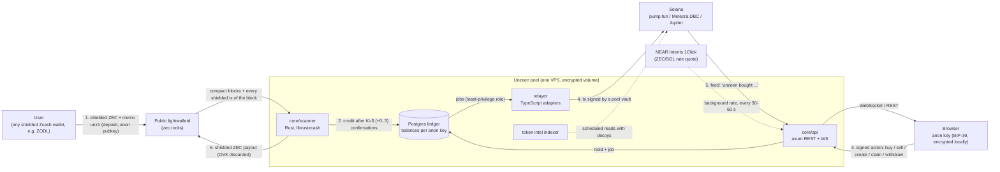

<!--
DRAFT for the public README.md (analyst, 2026-10-13). Not the README yet.
Before publishing:
  1. Resolve every `TODO(lead):`.
  2. Until 28.10: delete every block between a pair of FAIR-LAUNCH markers (8 pairs), together with this comment.
  3. On 28.10, right before the repo goes public: keep the fair-launch blocks, remove the markers.
Sources: docs/ARCHITECTURE.md, FEATURES.md, STACK.md, API.md v0.9, STATUS.md, docs/analysis/*.md, infra/README.md, code.
-->

# Unzeen

> **Launch anywhere. Stay unzeen.**

Unzeen is a privacy layer for Solana launchpads, paid for with shielded ZEC.

You top up once from any Zcash wallet with shielded ZEC. After that you buy, sell and launch tokens on **pump.fun** and **Meteora DBC** (and trade anything Jupiter routes, on mainnet). The trades are executed by the pool's shared Solana vaults. The feed says *"unzeen bought 1.2M $PEPE"*. It never says who.

- No Solana wallet, no email, no sign-up: your account is a 12-word **anon key** generated and encrypted in your browser.
- The price stays public (the bonding curve and the feed are on-chain). The participants do not. This is the dark-pool thesis of the **Private Markets** track.
- Built for **ZECATHON 2026** (Sep 28 – Oct 28, 2026). Track: **Private Markets**.

Demo: `TODO(lead): demo URL` · Video: `TODO(lead): video URL` · Twitter: "stay unzeen" `TODO(lead): handle/link`

---

## Contents

1. [How it works](#how-it-works)
2. [Features](#features)
3. [Trust model](#trust-model)
4. [Threat model: what stays private and what does not](#threat-model-what-stays-private-and-what-does-not)
5. [What is real and what is a mock](#what-is-real-and-what-is-a-mock)
6. [Built during ZECATHON](#built-during-zecathon)
7. [Running locally](#running-locally)
8. [Roadmap](#roadmap)
9. [License](#license)

---

## How it works



### 1. Account

The browser generates a BIP-39 phrase (12 words) and derives an ed25519 **anon key** from it (SLIP-0010, a separate key per network). The phrase is encrypted in the browser (PBKDF2, 600k iterations, AES-GCM) and never leaves it. The server only ever sees the public key.

### 2. Top up (the only Zcash transaction you make)

The browser builds a ZIP-321 payment request (QR or link) to the pool's shielded address. The memo is a compact binary `unz1` record, `op = deposit` plus your anon pubkey, signed by the anon key. The server does not learn that you intend to top up until the note shows up on chain.

The scanner downloads **every** shielded transaction of every block, not only the ones that pay the pool, so the lightwalletd operator cannot tell which transactions are deposits. After K = 3 confirmations (plus a random 0–3 blocks) the deposit is credited to the anon key's balance in ZEC. Minimum deposit: 0.001 ZEC.

### 3. Actions from the balance

Every action is an HTTP request signed by the anon key (domain-separated, with chain id, nonce and timestamp against replay, body padded to a fixed size). No Zcash transaction is involved, so the time of your deposit is not tied to the time of your trades.

| Action | What happens |
|---|---|
| `buy` / `sell` | ZEC is converted at the pool rate (NEAR Intents 1Click quote, refreshed in the background, 0.5 % pool spread). A pool vault trades on pump.fun / Meteora DBC / Jupiter. Proceeds come back to your ZEC balance. |
| `create` | A fresh creator address of the pool launches your token. The creator rights live on your anon key in the ledger. Image metadata (EXIF) is stripped and the image is re-encoded on our server. |
| `claim` | Creator fees are collected by the pool for all tokens on a fixed schedule, never on request. `claim` is a ledger-only credit to your balance. |
| `withdraw_zec` | Shielded payout to any Zcash unified address after a 1–10 min delay (10–60 min in Max privacy). Up to 5 payouts are batched per transaction. |
| `withdraw_token` | Tokens go to a **new** Solana address, always with a small SOL drop for gas and a random delay (30 s – 5 min, or 10–60 min). Optional *smart withdraw*: split into 2–5 parts of unequal size (±20 %) to 2–5 addresses with independent delays. |
| `order_create` / `order_cancel` | Private limit / take-profit / stop-loss orders kept **only in the pool's ledger**, never on chain. |

### 4. Execution modes

Selected next to the Buy/Sell button. The default comes from your profile and is **Delayed**.

| Mode | Latency | How |
|---|---|---|
| **Delayed** (default) | 30–60 s | Actions wait for the next epoch boundary (random 30–60 s, on a schedule that does not depend on requests) and run as a batch in random order. |
| **Max privacy** | 5–15 min | Same, with longer epochs. |
| **Now** | ~1–3 s | Executed immediately. buy / sell / create only, never withdrawals. A flat fee from `PoolInfo.fees` is taken from the balance. |

Every pool transaction, in every mode, uses the same quantized compute-unit price and (on mainnet) the same Helius Sender tip, so Now trades carry no on-chain marker. See the [threat model](#execution-modes-and-timing) for what Now does *not* protect against.

### 5. Verify

`/verify` lets anyone check that the pool is solvent without learning anything about its users. See [Trust model](#trust-model).

<!-- FAIR-LAUNCH: publish on 28.10 -->
### 6. Fair launch (sealed bids)

A launch can be run as a sealed-bid fair launch, the closest thing on Solana to *"the price should be public and the participants should not"*:

1. **Bid window (N minutes).** Each participant's amount is encrypted in the browser with **drand timelock (tlock, quicknet)** to a round that comes after the window closes. Nobody can read the bids before that round: not other bidders, not the creator, not the operator. The browser never talks to drand: the quicknet parameters are pinned in the client. The balance hold is a **denomination** from a fixed grid (0.05 / 0.1 / 0.25 / 0.5 / 1 / 2.5 / 5 / 10 ZEC), and the sealed amount is at most that.
2. **Commitment root.** When the window closes, *before* the drand round, the pool builds a Merkle tree whose leaves are hashes of the ciphertexts (no contents), publishes the root through the API and writes it to Solana in a memo transaction signed by the pool's attestation key. That is an unforgeable timestamp: the set of bids was fixed before anyone could decrypt it. Each participant can check that their bid is included.
3. **Reveal and execution.** After the drand round, the server verifies the round signature (BLS, `drand-verify`), decrypts the bids (`tlock_age`) and sends **one atomic Solana transaction**: `create + buy(sum of all bids)`. The mint does not exist before this transaction, so nobody can buy earlier or at the launch price.
4. **Allocation.** Everyone gets the same price: tokens are split pro rata (`floor`, dust stays with the pool). The total buy is capped (25 % of supply by default; oversubscription scales every bid down by the same ratio). The creator's own bid is bound by the 5 % creator cap.

What is public: token metadata, the close time and the round. The number of bids is shown only when there are at least 5 (otherwise "<5"). The ciphertexts are never published.

Honest limits:
- The operator sees each bid's **denomination** (an upper bound) before the round, and the exact amount only after the round, like everyone else.
- Nobody can buy before or at the launch price, but anyone can buy **right after** it (same slot, higher price). The round time is public.
- The on-chain attestation proves **when** the bid set was fixed, not **what** it contained: the sum of bids cannot be checked publicly because the ciphertexts are not published.
- The creator fee generated by the launch transaction itself goes to the pool, not to the creator. Later creator fees go to the creator. `TODO(lead): STATUS risk says the launch-tx fee is not yet routed to the pool in all cases; confirm before publishing.`
<!-- FAIR-LAUNCH: publish on 28.10 -->

---

## Features

**Core**
- Account on an anon key (12 words), no email, no wallet.
- ZEC balance: top up once, then act instantly from the balance.
- Buy / sell on pump.fun and Meteora DBC; any token Jupiter routes (mainnet).
- Anonymous token launch with a fresh creator address per token.
- Creator fee claim to the balance.
- Withdraw ZEC to any shielded address; withdraw tokens to a new Solana address with gas, delay, optional split.
- Live feed *"unzeen bought…"*, token pages with chart and trades.
- Execution modes Now / Delayed / Max privacy.
- Verify: Merkle-sum proof of liabilities, signed public vaults, attested ZEC reserve. No viewing key, ever.
<!-- FAIR-LAUNCH: publish on 28.10 -->
- Sealed-bid fair launch (drand tlock, commitment root anchored on Solana, one atomic create+buy, one price for everyone).
<!-- FAIR-LAUNCH: publish on 28.10 -->

**Extra**
- Private limit / take-profit / stop-loss orders, stored only in the pool's ledger (open orders expire after at most 72 h; Delayed / Max privacy only).
- Smart withdraw (2–5 addresses, random delays).
- Anonymous creator cabinet (signed request, response padded to a fixed size).
- Token safety panel: mint/freeze authority, top-10 holders and dev share (pool vaults excluded), curve progress / graduation / LP, socials. Unzeen launches show **"dev anonymous, rules enforced"**: the pool enforces a 24 h lock on the creator's initial buy and a 5 % cap on the creator's share through the pool.
- Fast trading: presets, slippage/priority settings, PnL and own-trade markers computed **in the browser only**, trade filters.
- Search by contract address.
- Public `/stats`: daily snapshot, rounded, k-anonymous (any category with fewer than 5 events shows "<5").

All token data comes through our backend. The browser never calls Solana RPCs, Jupiter or IPFS gateways directly.

---

## Trust model

Unzeen is a **custodial pool** in this version. We say so plainly.

**The operator is trusted with:**
- **The vault keys** (Solana) and the pool's Zcash spending key. The operator could steal funds.
- **The ledger**: which anon key holds what, and which actions it took. The operator could link an anon key to its trades.
- **Enforcing the rules**: creator lock and cap, order execution, payouts.

**What reduces that trust, and how far it goes:**
- The ledger and the pool wallet live on an **encrypted volume** (LUKS/gocryptfs) that the owner unlocks by hand after every reboot. The age key of the seed is stored outside the data volume. Provider snapshots and backups are disabled.
- Retention is short: action amounts are zeroed after **24 h**, ledger/token journals and finished jobs are deleted after **48 h**, closed orders after 48 h, and per-user Verify data after 48 h. What cannot be deleted is the **current** state (balances and open positions).
- The pool's viewing key (UFVK/IVK/OVK) is **never published**, not to auditors either. Payouts use `OvkPolicy::Discard`, so the pool keeps no record of whom it paid.

**What Verify proves (anyone can check, in the browser or offline with `verify-proof.mjs`):**

| Claim | Status | How |
|---|---|---|
| Your balance is counted in the liabilities | **Proven** to you | Daily Merkle-sum tree per asset. Each balance is split into 2–4 random pieces with fresh blinding, the tree is padded with dummy leaves to ≥ 1024, nodes commit to both child sums (no negative leaves). Your signed, padded (64 KiB) proof is checked in the browser. |
| Everyone sees the same roots | **Proven** | Roots are signed by the operator key (pinned in the frontend build and below) and anchored in a Solana memo transaction. |
| Solana vaults belong to the pool and hold the tokens/SOL | **Proven** | Each vault signs the snapshot with its own key; balances are read at one finalized slot. Token liabilities ≤ vault balances, per mint, with no rounding slack. |
| The pool holds enough ZEC | **Attested, not proven** | Proving a shielded (Ironwood) balance without a viewing key is not possible today: ZIP 311 payment disclosures are a Draft, Sapling-only, without an implementation, and revealing individual notes would reveal deposit transactions. The operator signs a reserve statement (rounded down to 0.01 ZEC). ZK proof of reserves is on the roadmap. |

Verify does **not** prove:
- that the operator did not omit users who never check their proof (a known limit of every proof-of-liabilities scheme);
- anything about the operator's honesty in linking keys to trades;
- the ZEC reserve (see above).

What Verify publishes: one snapshot per day at 00:00 UTC, the roots and their sums, the padded tree size, the vault list. It does **not** publish the number of users, anyone else's balance, or any viewing key. Between two snapshots an observer only sees the daily change of the aggregates.

Operator attestation keys: `TODO(lead): base58 pubkey for devnet and mainnet (= NEXT_PUBLIC_ATTESTATION_PUBKEY_*)`.
<!-- FAIR-LAUNCH: publish on 28.10 -->
A second, separate key signs fair-launch attestations: `TODO(lead): its pubkey, per decision F14/E19.`
<!-- FAIR-LAUNCH: publish on 28.10 -->

---

## Threat model: what stays private and what does not

"Leaks are disqualifying", so here is the full list, including the leaks we could not close.

### On-chain observer (Zcash and Solana explorers)

**Zcash side**
- A deposit is a shielded Ironwood transaction to *an* address. Sender, amount, recipient and memo are encrypted. The pool address is public, but a shielded payment to it looks like any other Ironwood transaction.
- **Exception:** paying from a **transparent address** or **directly from an exchange** reveals the source and the amount, and the exchange learns you paid Unzeen. The app tells you to pay only from a shielded balance.
- Payouts (`withdraw_zec`) are shielded, delayed and batched. The pool keeps no outgoing viewing data.
- A shielded transaction in block B followed by a trade a few minutes later is a weak timing hint when there are few Ironwood transactions per block. Crediting waits K = 3 plus a random 0–3 blocks; the UI suggests topping up in advance.

**Solana side**
- Every trade, launch and withdrawal is signed by one of the pool's **public vaults** (listed on `/verify`). An observer can attribute any of them to "Unzeen", never to a person, a Zcash transaction, a deposit or an anon key. That mapping exists only in the pool's ledger.
- All positions in one token are held on **one vault** (a shared inventory for that token). Launches use a **fresh creator address** per token, so two launches by the same person are not linked on chain.
- Delayed / Max privacy trades run in batches in random order. Now trades look the same on chain: same compute-unit price, same tip, no marker. Order-triggered trades use the same `min_out` rule as manual trades (from the public tick price, rounded down to 3 significant digits), so the trigger price cannot be read from the transaction. `TODO(lead): E4 fix is in the working tree, not committed at the time of writing; confirm before publishing this sentence.`

**What an on-chain observer can still do:**
- **Group Unzeen trades by token.** If you are the only Unzeen user trading a small token, all Unzeen trades in it are yours. That is a pseudonymous position, not an identity.
- **Match a token withdrawal to a buy by amount.** Withdrawing exactly what you bought links the recipient address to that buy. The UI warns when the amount matches a recent buy. Withdraw a different amount, wait, or use smart withdraw.
- **See that the recipient was funded by Unzeen** (the gas drop comes from a pool vault). Keep the recipient separate from your main wallet.
- **Probe orders at the pool level.** By moving a price and watching for "unzeen sold", someone can learn that the pool has a stop near a level. It never reveals who placed it. A take-profit or stop-loss on a whole position sells the same amount as the public buy.
- **Small anonymity set.** Privacy grows with the number of users. With a handful of users during judging, batches often hold 0–1 actions, and an Unzeen trade in a quiet token is almost certainly one person's. We do not fake traffic to hide this.

### Network observer

Your ISP, Wi-Fi operator, VPN provider, or our hosting provider can see *when* you talk to our server (not what: TLS, and request bodies are padded to a fixed size).

<a id="execution-modes-and-timing"></a>
**Execution modes and timing.** Every trade is executed by a shared pool vault, so the chain never shows who traded. What remains is timing. In **Delayed** (default) actions wait for the next pool batch (every 30–60 s; 5–15 min in **Max privacy**) and run in random order, so someone watching the network can only narrow your request down to a batch. That protection is only as strong as the number of other people in the same batch, and while Unzeen's volume is small it is weak. **Now** executes in 1–3 s. On-chain it looks exactly like every other pool trade: same fee profile, no marker. But anyone who can see your connection (your ISP, Wi-Fi operator, VPN provider, or the hosting provider of our server) can match the moment you sent a request to the trade that follows it. Use Tor or a trusted VPN if that matters to you. Choosing Now also shrinks the batches that Delayed users hide in. Withdrawals are never instant: they always use a delay, because an instant withdrawal would link a trade to the receiving address on-chain, not just on the network. We never fetch prices or fee estimates at the moment of your action: the ZEC/SOL rate and fee levels are refreshed in the background on a fixed schedule.

Other measures against a network observer:
- Action status is delivered through the regular portfolio poll (fixed interval, padded response), not by polling a single action until it completes, so the end of polling does not reveal the execution time.
- The public key is sent in a header, never in a URL path.
- Opening a transaction in an explorer from the app reveals your IP to that explorer. Use Tor/VPN for explorers.

### Hosting provider (VPS)

- Sees network metadata: client IPs and timing of requests to our server. Same as the network observer above.
- Does **not** get our logs: there are none to get. Reverse-proxy access logs are off (or without IP and path), `X-Forwarded-For` is never logged, rate limits are in memory, Next.js telemetry is off, Docker logs rotate, Postgres logs no statements or connections. No CDN or third-party proxy in front of the server.
- Data at rest is on an encrypted volume with manual unlock; provider snapshots and backups are disabled.
- **Not covered:** a provider that reads the memory of the running, unlocked machine can read the ledger. That is part of operator trust.

### lightwalletd operator (public `zec.rocks`)

- We do not run our own Zebra node; the scanner uses public lightwalletd servers.
- Sees the pool server's IP and what it downloads. Because the scanner downloads **every** shielded transaction of each block, it cannot tell which ones are deposits.
- **Sees that the pool broadcasts a payout transaction, and when** (not the recipient, not the amount). Closing this needs our own node or Tor (roadmap).

### Solana RPC providers (Helius, Shyft)

All RPC traffic comes from our server; the browser never calls an RPC. Providers never see user IPs or anon keys, only pool-level activity.
- Reads and sends are **split across providers**: **Shyft** serves all reads (curves, token data, prices); **Helius** gets only background priority-fee estimates (for the venue programs, never for a specific vault or mint), transaction sends through Helius Sender, and the top-10-holders call, which Shyft's free plan does not offer.
- Token lookups by contract address run on the indexer's **tick**, in fixed-size batches padded with **decoy** tokens, never at the moment a user searches. This blurs the link "someone looked up X → the pool bought X", but does not remove it completely.
- A provider that keeps logs (or is compelled to share them) together with the hosting provider's network view could correlate Now trades with request times. Same caveat as Now above.

### Jupiter (mainnet only)

When a trade is routed through Jupiter, Jupiter's API sees the vault, the mint and the amount **at execution time**. It is never called for user quotes, page views or prices. The transaction is built, checked against an instruction allowlist, simulated and sent by our own pipeline, never through Jupiter's execution service.

### NEAR Intents 1Click

Used only for a **dry quote of 1 ZEC → SOL**, refreshed in the background every 30–60 s. 1Click learns nothing about users or the timing of actions. NEAR Intents accepts only transparent ZEC, so it is never used for user payouts. `TODO(lead): pool SOL rebalancing via 1Click is manual in this version (no rebalancing code in the repo); confirm wording.`

### Database leak

If the ledger database leaked:
- Within 24 h of an action, its amounts could be matched to the public trade. After 24 h amounts are zeroed; after 48 h journals are deleted.
- Current balances and open positions remain. With a single buy, a position equals the amount of that public buy.
- The pool wallet database (`wallet.sqlite`) holds the decrypted deposit memos (anon pubkeys) and txids.
- This is why everything sits on the encrypted volume, but it remains part of operator trust.

### Creator rules

The creator lock (24 h) and cap (5 % of supply) apply to **the launching anon key**. A creator can bypass them with a second anon key: the pool cannot close that without linking keys, which would break privacy. The UI says "rules apply to the launching key". There is no numeric creator reputation ("N launches, M rugs"), because it would link launches by construction.

### Your device

The encrypted key blob and UI preferences (for example, the default execution mode) are in `localStorage`. Anyone with access to your unlocked device can see that you use Unzeen. Proofs and balances are never stored there.

---

## What is real and what is a mock

The app has a **Devnet / Mainnet** switch in the header. Each network has its own backend (core + relayer + Postgres) and its own state.

| Part | Devnet mode | Mainnet mode |
|---|---|---|
| Zcash | **Real**, Zcash **testnet** (TAZ), public `testnet.zec.rocks` | **Real**, Zcash mainnet, `zec.rocks` (+ `na.`/`eu.` fallbacks) `TODO(lead): confirm the live mainnet run (STATUS: mainnet init/sync not verified at the time of writing)` |
| Solana venues | **Real**, Solana **devnet**: pump.fun and Meteora DBC (create, buy, sell, withdraw; e2e runs finalized on devnet) | **Real**: pump.fun, Meteora DBC, Jupiter `TODO(lead): list mainnet tx links from the demo run` |
| Jupiter | Not available (Jupiter has no devnet) | Real |
| ZEC/SOL rate | **Fixed** rate (`DEVNET_ZEC_SOL_RATE`) | Real NEAR Intents 1Click quote |
| Transaction sending | Plain `sendTransaction` (Helius Sender is mainnet-only) | Helius Sender with a uniform tip |
| Priority fee | `getRecentPrioritizationFees` | Helius estimate, background, quantized |
| Verify | Real; snapshots also triggered manually by the operator for the demo | Real, daily 00:00 UTC |
| ZEC reserve | Attested by the operator (not a mock, not a proof) | same |
| Pool SOL rebalancing (ZEC → SOL) | Manual | Manual `TODO(lead)` |
| Demo keys for judges | 3–5 **pre-funded demo anon keys** `TODO(lead): where they are published` | none: use your own funds at your own risk, or watch the video |

**Not real / not built:**
- The frontend contains an **in-browser mock API** (`NEXT_PUBLIC_API_MODE=mock`) used for UI development and tests. The public deployment runs with `NEXT_PUBLIC_API_MODE=real`. `TODO(lead): confirm the public build flags.`
- Token chat (`op: chat`) is not implemented (the API answers 400).
- "Whales" / "Dev" trade filters, dev history and sniper metrics are designed but **off** (they need a paid streaming RPC plan).
- Pulse, watchlist, Telegram bot, Tor mirror, multisig vaults, FROST, ZK proof of reserves: roadmap only.
<!-- FAIR-LAUNCH: publish on 28.10 -->
- Fair launch: real (drand quicknet, real Solana transactions), enabled on the public deployment only from Oct 28; before that it was compiled out of the public frontend bundle and disabled on the server.
<!-- FAIR-LAUNCH: publish on 28.10 -->

**Mainnet:** Unzeen is an unaudited custodial pool. The mainnet deployment exists to show that it works with real venues; it is not an invitation to deposit meaningful funds. Mainnet sends are gated by a flag and capped (payouts ≤ 0.05 ZEC per payout by default).

---

## Built during ZECATHON

All code in this repository was written during the ZECATHON build window (**Sep 28 – Oct 28, 2026**); the first commit is dated Oct 12, 2026. See the commit history. Nothing here is a fork of an existing launchpad, wallet or trading product; we use libraries and public APIs only.

`TODO(lead): if any code pattern was adapted from zcash-devtool, add an attribution line here.`

**Rust (`core/`)**
- librustzcash: `zcash_client_backend`, `zcash_client_sqlite`, `zcash_keys`, `zcash_primitives`, `zcash_protocol`, `zcash_address`, `zcash_proofs`, `zip32`, `zip321` (pre-release versions pinned, required for the current network upgrade), `orchard`, `sapling-crypto`
- `tonic`, `prost` (lightwalletd gRPC), `rustls`
- `axum`, `tokio`, `tower-http`, `reqwest`
- `tokio-postgres`, `deadpool-postgres`, `rusqlite`
- `ed25519-dalek`, `sha2`, `hmac`, `age`, `bip0039`, `secrecy`, `zeroize`
<!-- FAIR-LAUNCH: publish on 28.10 -->
- `tlock_age`, `drand-verify` (fair launch)
<!-- FAIR-LAUNCH: publish on 28.10 -->
- `serde`, `clap`, `tracing`, `thiserror`, `anyhow`, `bs58`, `hex`, `base64`, `rand`

**TypeScript (`adapters/`, relayer and indexer)**
- `@pump-fun/pump-sdk` 4.0.0, `@meteora-ag/dynamic-bonding-curve-sdk` 1.5.13
- `@solana/web3.js`, `@solana/spl-token`
- `age-encryption`, `pg`, `sharp` (image re-encoding), `bn.js`, `bs58`
- `vitest`, `tsx`, `typescript`

**Web (`web/`)**
- Next.js 16, React 19, Tailwind CSS 4, shadcn/ui (Radix), Motion, Phosphor Icons, Geist
<!-- FAIR-LAUNCH: publish on 28.10 -->
- `tlock-js` 0.9.0 (fair launch; the browser never talks to drand)
<!-- FAIR-LAUNCH: publish on 28.10 -->
- `@noble/curves`, `@noble/hashes`, `@scure/bip39`, `@scure/base`
- `lightweight-charts`, `qrcode.react`, `three` / `@react-three/fiber`, `sonner`

**External services:** public lightwalletd (zec.rocks), Helius (Free), Shyft (Free), Jupiter Swap API, NEAR Intents 1Click (quotes only), Pinata (optional, token metadata).
<!-- FAIR-LAUNCH: publish on 28.10 -->
Fair launch: drand quicknet relays (server only).
<!-- FAIR-LAUNCH: publish on 28.10 -->

---

## Running locally

Requirements: Rust (edition 2024), Node.js ≥ 20, pnpm 10, Docker. `TODO(lead): minimum Rust version.`

All secrets live in the repo-root `.env` (git-ignored) and in `~/.unzeen/<network>/` (0700/0600), never in the repo. Mainnet sends are refused unless explicitly allowed.

### 1. Postgres

```bash
cp .env.example .env    # set POSTGRES_PASSWORD (openssl rand -hex 16) and DATABASE_URL
docker compose -f infra/docker-compose.yml --env-file .env up -d postgres
```

Bound to `127.0.0.1` only. Migrations are embedded in the core binaries and applied on start. The relayer and the indexer use their own least-privilege roles: apply `infra/relayer-role.sql` and `infra/indexer-role.sql` (idempotent; re-run after new migrations) and set `DATABASE_URL_RELAYER` / `DATABASE_URL_INDEXER`. `TODO(lead): exact psql command for the role scripts.`

### 2. Core (Zcash scanner + API)

```bash
cd core && cargo build --release
B=./target/release/unzeen-scanner
$B seed-keygen --out ~/.unzeen/seed.agekey   # once; set UNZEEN_SEED_KEY_FILE in .env
$B init                                      # encrypted pool seed + wallet, prints the pool address
$B serve                                     # sync + credit deposits (add --payouts for the withdraw_zec executor)
./target/release/unzeen-api serve            # API on API_BIND (default 127.0.0.1:8080)
curl -s localhost:8080/api/pool
```

`UNZEEN_NETWORK=testnet` for local work. Testnet ZEC (TAZ) is scarce (faucet ~0.125 TAZ/day).

### 3. Relayer and indexer (Solana)

```bash
cd adapters && pnpm install
pnpm keys:gen 2          # vault keys in ~/.unzeen/devnet/solana (age-encrypted when SOLANA_KEYS_AGE_KEY_FILE is set)
pnpm relayer:run         # executes jobs from Postgres
pnpm intel:run           # token data indexer (Shyft read URL in SOLANA_READ_RPC_URL_DEVNET)
pnpm media:serve         # dev only: serves re-encoded token images on 127.0.0.1
pnpm test
```

Fund the devnet vaults with devnet SOL. Put RPC URLs into `.env` (`SOLANA_RPC_URL_DEVNET`, `SOLANA_READ_RPC_URL_DEVNET`); see `adapters/.env.example`. `TODO(lead): Meteora DBC config step (pnpm meteora:config) if needed for a fresh setup.`

### 4. Web

```bash
cd web && pnpm install
cp .env.example .env.local
pnpm dev                 # in-browser mock API by default (no backend needed)
# against the local backend:
NEXT_PUBLIC_API_MODE=real NEXT_PUBLIC_API_URL_DEVNET=http://127.0.0.1:8080 pnpm dev
pnpm test
```

The API must allow the web origin: `API_CORS_ORIGINS` in `.env`.

### 5. Verify a proof offline

Download the snapshot and your proof from `/verify`, then:

```bash
node web/public/verify/verify-proof.mjs snapshot.json proof.json
```

`TODO(lead): confirm the script's arguments and that it runs with only @noble/hashes.`

### Production notes

See `infra/README.md`: TLS on the same host, access logs off, no CDN proxy, one origin per network with the API at the root, WebSocket upgrade for `/ws/feed`, data on an encrypted volume.

---

## Roadmap

- **Multisig vaults (Squads)** on Solana and **FROST t-of-n** for the pool's Zcash key: remove single-operator custody.
- **ZK proof of reserves** over Ironwood notes (sum of unspent pool notes ≥ X, without revealing notes or a viewing key).
- **Tor**: `.onion` mirror of the app; lightwalletd over Tor or a self-hosted node (closes the payout-timing leak to lightwalletd).
- Cover activity by the pool in each epoch so Delayed batches are never a batch of one.
- **Pulse**: New / About to graduate / Graduated.
- **Watchlist and alerts**, Telegram bot.
- Anonymous token chat (per-token nicknames that do not link across tokens).
- Anonymous creator reputation without linking launches (ZK proofs).
- Privacy meter: an estimate of how linkable each action is.
- Selective disclosure: a signed export of your own trades (for taxes).
- "Prove you are the creator": a public signature with the anon key.
- More venues (stonk.fun and other LaunchLab launchpads are already reachable through Jupiter routing).
<!-- FAIR-LAUNCH: publish on 28.10 -->
- Fair launch v2: splitting the launch buy across several vaults in one Jito bundle (mainnet).
<!-- FAIR-LAUNCH: publish on 28.10 -->

---

## License

MIT. See [LICENSE](LICENSE). `TODO(lead): add the LICENSE file at the repo root (not present yet); Cargo workspace already declares MIT.`
